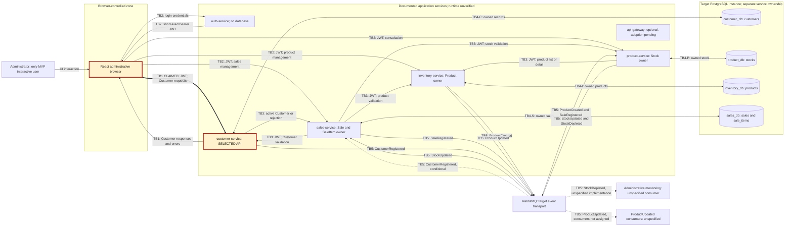

# CP1 - Attack Surface and Trust Boundaries

## Scope and evidence status

Project: By_Sellens; domain: Customer; owner: `AnaMariaCharry`. Selected boundary: **Administrator browser -> Customer API**. Claim reference supplied by the student: [Docs issue #52](https://github.com/code-corhuila/bysellens-docs/issues/52); its contents were not independently accessible through the available connection.
This map describes the second-cut target in the supplied `bysellens-docs-main (1).zip`, not deployed infrastructure. Sources are listed below by exact archive-relative path. No source from `13-operations` is used.
The earlier Week 11 evidence establishes a React Customer portal with `ClienteForm`, `Clientes`, `clienteService` and `mockClientes`, plus a separate TypeScript instrumentation laboratory. It does not prove that the documented Java/Spring Customer API, JWT enforcement, PostgreSQL or RabbitMQ integration operates. The portal's older `/api/clientes` adapter and extra form fields must not be confused with the target `/api/v1/customers` contract.

## Documented data-flow diagram

Solid arrows represent documented target flows, not observed traffic. Dotted arrows represent conditional or unspecified relationships. The thick TB1 arrow and highlighted Customer node identify the claimed boundary. Return arrows carrying personal data are shown explicitly for Customer.

Gateway is retained as an optional component without routing arrows: adoption and concrete forwarding topology are not established. It must not be inserted as a mandatory hop. No external business API is defined for the MVP; no payment provider, identity SaaS, notification service or external customer login is invented. Business Customers are stored entities, not interactive users in this cut.
Auth signs JWTs using protected configuration; verification keys are configured independently in each business service. This is not a per-request Customer-to-Auth introspection flow. Auth has no documented authentication database, Redis dependency or broker dependency in the accepted design.
The domain event catalog defines the events drawn above. `CustomerRegistered` is documented on `customers.customer-registered`; Sales consumption is conditional. Unspecified ProductUpdated consumers and administrative monitoring are not extra deployed microservices. Exchanges, queues, bindings and transport provisioning remain unverified.

## Trust-boundary interpretation

| Label | Less-trusted or separately governed side -> receiving side | Data / security significance |
| --- | --- | --- |
| **TB1 - selected** | Administrator-controlled browser -> Customer API | Bearer JWT, Customer inputs and identifiers; personal-data responses cross back. Server-side authentication, ADMIN checks and schema validation are documented requirements, not proven controls. |
| TB2 | Browser -> Auth or other business APIs | Credentials at login; JWT and domain requests elsewhere. Local UI checks do not establish server trust. |
| TB3 | One service identity/context -> another service API | Sales validates Customer through REST; Product/Sales consult other owners. Receivers validate the forwarded token independently; internal network location alone grants no access. |
| TB4-C/P/I/S | Each service -> its separately owned database | Customer/Stock/Product/Sale records cross persistence and credential boundaries, even with one shared physical PostgreSQL instance. No cross-service direct table access is authorized by this design. |
| TB5 | Services -> broker -> independently executing consumers | Event payloads and metadata cross publisher/consumer trust domains; schemas and broker credentials require validation. Browser JWTs must not become event credentials. |

These are analytical trust labels for documented boundaries, not claims of deployed firewalls, network segmentation, TLS termination or configured broker ACLs. Deployment origins, actual ports, transport protection and enforcement tests require verification.

## Customer asset inventory

Classifications below are proposed analysis decisions, not proof of implemented access controls. `public` means safe for unrestricted disclosure; `internal` means operational use; `confidential` covers business/personal data; `restricted` covers access-granting secrets. No Customer personal-data asset is classified public.

| Asset | Documented location / copies | Classification |
| --- | --- | --- |
| Customer UUID / historical customer reference | `customer_db.customers.id`; Customer responses; Sales logical `customer_id` reference | confidential |
| Customer name | `customers.name`; create/PATCH input, responses, CustomerRegistered payload | confidential |
| Optional Customer phone | `customers.phone`; permitted API input/responses and documented event payload | confidential |
| Creation/update audit timestamps | `customers.created_at`, `updated_at`; Customer response timestamps | internal |
| Logical-deletion state | `customers.deleted_at`; lifecycle/active-record filtering | confidential |
| CustomerRegistered business payload and envelope | Target broker channel `customers.customer-registered`; conditional Sales recipient | confidential |
| Administrator Bearer JWT used for Customer access | React memory, Authorization header, receiving Customer security context; not a Customer account field | restricted |
| Customer persistence credentials | Protected service configuration for the target Customer database; actual provisioning pending | restricted |

Current target Customer data is name plus optional phone, generated ID and lifecycle/audit fields. Legacy email/address/notes are excluded from the new API but must not be deleted merely because the target schema differs. Precise retention, phone normalization and operational redaction details remain pending.

## Entry points of TB1

All paths include the OpenAPI server prefix `/api/v1`; deployment host and port are unverified. Bearer authentication means the documented RS256 signature/key, issuer `bysellens-auth`, audience `bysellens-api` and expiration checks; authorization separately requires `ADMIN`, not OAuth scopes or Customer ownership inferred from a user-supplied ID.

| Endpoint / interface | Initiator | Authentication required by design | Authorization required by design |
| --- | --- | --- | --- |
| `POST /api/v1/customers` | Administrator browser; create name and optional phone | Valid Bearer JWT | ADMIN; validate create schema; reject client-assigned identifiers/audit fields |
| `GET /api/v1/customers` | Administrator browser; paginated active list | Valid Bearer JWT | ADMIN; bounded documented pagination |
| `GET /api/v1/customers/{id}` | Administrator browser; active Customer detail | Valid Bearer JWT | ADMIN; validate UUID and exclude unknown/deleted records |
| `PATCH /api/v1/customers/{id}` | Administrator browser; permitted name/phone change | Valid Bearer JWT | ADMIN; validate UUID and allowed update fields |
| `DELETE /api/v1/customers/{id}` | Administrator browser; logical deletion | Valid Bearer JWT | ADMIN; preserve history; no physical-delete permission implied |
| `GET /api/v1/health` | Authorized diagnostic caller or browser; not a Customer CRUD operation | None in the actual Customer OpenAPI health exception | No ADMIN requirement; only documented status/dependency labels, not personal data or credentials |

The authenticated Sales lookup reaches the same Customer detail API through TB3, not the selected browser boundary. Login occurs at `POST /api/v1/auth/login` through TB2; it is not a Customer account-registration endpoint. CORS preflight handling, where needed, does not authorize the subsequent CRUD call. Missing/invalid authentication is documented as 401; a valid identity without ADMIN as 403. Runtime enforcement remains unverified.

## Sources, inconsistencies and verification limits

Exact paths within the ZIP snapshot:

- `03-product/vision.md`: administrative user and second-cut authentication update; `05-architecture/overview.md`: services, target flows, storage and optional gateway.
- `05-architecture/decisions/records/ADR-002-second-cut-authentication.md` and `07-api/authentication.md`: accepted ADMIN/JWT design, protected configuration, internal forwarding and implementation-pending status.
- `07-api/contracts/openapi/customer-service.yaml`: authoritative Customer methods, `/api/v1` prefix, Bearer/ADMIN requirements and explicit public health exception; `07-api/contracts/openapi/sales-service.yaml`: Customer validation from Sales.
- `06-data/models.md`: four target databases, Customer fields, history retention and pending migration; `02-domain/domain-events.md`: actual event names, producers and conditional/unspecified recipients.
- `04-requirements/non-functional.md`: NFR-003 personal-data/security requirements; `09-microservices/services/05-customer-service/README.md`: Customer scope and pending runtime implementation.

Some archive documents are stale: the general service catalog denies contracts/authentication that the specific OpenAPI/ADR files now define, and the Customer service README says no health operation although its actual contract contains one. Use the specific contracts and accepted second-cut decisions for this map; retain these discrepancies as verification work rather than inventing runtime behavior.
The Mermaid diagram uses standard flowchart syntax and was reviewed structurally. Direct rendering in GitHub has not been verified. Deployed services, database/broker provisioning, JWT/ADMIN enforcement, TLS/CORS settings, event delivery and the content of issue #52 remain unverified. No CP0 content is changed, no reflection is authored, and no STRIDE analysis or later checkpoint is performed here.
