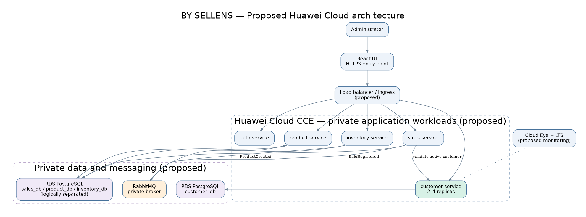

# Architecture design note — By_Sellens

> Template. Replace every `<...>`, delete this note and keep the six headings exactly as they are. Between 1,200 and 2,000 words, written by you. Text left as `<...>` counts as missing.

## 1. Target architecture

| Component in the diagram | Defined in (file of your team's -docs) |
|---|---|
| React frontend | `05-architecture/overview.md` |
| auth-service | `09-microservices/service-catalog.md` |
| customer-service | `09-microservices/services/05-customer-service/README.md` |
| sales-service | `09-microservices/services/06-sales-service/README.md` |
| product-service | `09-microservices/services/03-product-service/README.md` |
| inventory-service | `09-microservices/services/04-inventory-service/README.md` |
| PostgreSQL databases | `09-microservices/data-ownership-matrix.md` |
| RabbitMQ message broker | `05-architecture/overview.md` |

The proposed target architecture moves the By_Sellens system to Huawei Cloud while maintaining the microservices structure documented by the team. The system includes a React frontend and backend services developed with Java and Spring Boot. Each microservice has a specific responsibility, allowing the application to separate business functions and manage changes independently.
In this proposal, the frontend communicates with the backend through a secure HTTPS entry point and a load balancer. The microservices would run as containers using Huawei Cloud Cloud Container Engine (CCE). The application would use a Virtual Private Cloud (VPC) to separate public access from internal services and databases.
The customer-service microservice manages customer registration, consultation, updates, and logical deletion. It also supports the sales process because sales-service needs to validate active customers before registering transactions. For this reason, Customer is an important component of the proposed cloud architecture.
I propose deploying customer-service with at least two replicas distributed across different availability zones. A load balancer would distribute requests between the replicas, reducing the impact of an application instance failure.
For data storage, I propose using Huawei Cloud RDS for PostgreSQL. Each microservice would maintain ownership of its own database, following the existing architecture documentation. Customer would use `customer_db`, while Sales, Product, and Inventory would maintain their respective data stores.
RabbitMQ would continue supporting asynchronous communication where it is defined in the current system. The cloud design would preserve the existing communication contracts instead of introducing unnecessary dependencies.
This architecture is a proposal for future implementation. It does not mean that the services, databases, or cloud resources have already been deployed on Huawei Cloud.

## 2. Five principles

| Principle | Current weakness | Evidence in -docs | Design decision | Huawei Cloud service |
|---|---|---|---|---|
| Reliability | No verified multi-zone deployment for Customer | `09-microservices/services/05-customer-service/decisions.md` | Deploy Customer with multiple replicas across availability zones | CCE, RDS |
| Security | Customer information requires protected access and secure credentials | `09-microservices/services/05-customer-service/README.md` | Restrict access through private networking and permissions | VPC, IAM, DEW |
| Performance efficiency | No verified automatic scaling configuration | `09-microservices/service-catalog.md` | Scale services according to CPU utilization | CCE, Cloud Eye |
| Cost | Cloud infrastructure costs have not been evaluated | `05-architecture/overview.md` | Use controlled replica limits and monitor resource consumption | CCE, Cloud Eye |
| Operations | Automated cloud deployment and recovery are not verified | `09-microservices/services/05-customer-service/decisions.md` | Introduce monitoring, logging, and controlled deployment | LTS, Cloud Eye, SWR |

Reliability is important because Customer participates in the sales process. If customer-service becomes unavailable, sales-service may not be able to validate customers correctly. I propose using multiple application replicas and a highly available database configuration to reduce interruptions.
Security is necessary because Customer stores personal information. The proposed design would use private networks, access permissions, and protected credentials. The application must continue validating authentication tokens and authorization rules independently. Huawei Cloud security services would complement these controls rather than replace them.
Performance efficiency focuses on using resources according to actual demand. Instead of assigning excessive computing capacity permanently, the application would increase or decrease the number of replicas when necessary. This decision requires monitoring and load testing before production use.
Cost optimization is also important because running multiple cloud services can increase expenses. I propose starting with a limited number of instances and reviewing their consumption. Development and testing environments could use smaller configurations than production, provided they remain suitable for their purpose.
Operational excellence requires observing the system and responding to failures. Huawei Cloud Cloud Eye and Log Tank Service (LTS) would support monitoring and centralized logging. These tools would help identify errors, resource problems, and unexpected behavior in customer-service.
The five principles are connected. Improving reliability may increase costs, while increasing security may require additional configuration. The proposed architecture seeks a balance between these requirements without changing the existing responsibilities of the microservices.

## 3. Scalability

| Service | Scaling metric | Threshold (number and unit) | Min instances | Max instances |
|---|---|---|---|---|
| customer-service | Average CPU utilization | 70% for 5 minutes | 2 | 4 |
| sales-service | Average CPU utilization | 70% for 5 minutes | 2 | 4 |
| product-service | Average CPU utilization | 70% for 5 minutes | 2 | 4 |
| inventory-service | Average CPU utilization | 70% for 5 minutes | 2 | 3 |

Scalability allows the system to respond to changes in workload without requiring permanent manual adjustments. I propose using horizontal scaling through Huawei Cloud CCE to increase or decrease the number of application replicas.
For customer-service, the minimum would be two replicas and the maximum four replicas. If average CPU utilization remains above 70% for five minutes, the system would be configured to increase the number of replicas, subject to the maximum limit.
This configuration would help Customer process more requests during periods of high activity. Since Sales depends on Customer validation, maintaining sufficient Customer capacity is important for the complete sales workflow.
Sales and Product would follow similar scaling rules. Inventory would have a maximum of three replicas as an initial proposal, which could be changed after performance testing.
These numbers are proposed configuration values, not results obtained from actual production measurements. Before implementing them, the team would need to evaluate request volume, response times, memory consumption, and database connections.
Scaling application containers does not automatically solve database problems. Therefore, PostgreSQL performance must also be monitored to avoid excessive connections and slow queries.

## 4. Disaster recovery

- Critical data store: PostgreSQL database `customer_db`.
- RTO: 60 minutes
- RPO: 15 minutes
- DR pattern (chapter 11): Multi-availability-zone high availability with automated backups and point-in-time recovery.
- Why the pattern meets those numbers: A multi-zone database configuration would help reduce downtime caused by infrastructure failures, while automated backups and recovery logs would support data restoration. The proposed RTO and RPO must be validated through recovery tests before they can be considered guaranteed.

Disaster recovery is necessary because customer-service manages information required for customer operations and sales validation. A database failure could prevent the system from accessing customer records and affect the registration of sales.
I propose using Huawei Cloud RDS for PostgreSQL with automatic backups and a high-availability configuration across availability zones. This would reduce the operational work required to manage database availability and recovery.
The Recovery Time Objective (RTO) represents the maximum target time for restoring the service after an interruption. In this proposal, the objective is 60 minutes.
The Recovery Point Objective (RPO) represents the maximum acceptable amount of recent data that could be lost during a failure. I propose an RPO of 15 minutes.

To evaluate these objectives, the team would need to perform restoration exercises and measure the actual recovery time and recovered data. Backup retention, database configuration, and regional service availability would also need verification.
This strategy is related to ADR-C3-02, which proposes database protection and recovery for Customer. It is not an implemented or tested disaster recovery solution.

## 5. Automated deployment

| Stage | Trigger | Tool or service | File in your team's repositories |
|---|---|---|---|
| Build | Push or pull request to a development branch | Maven, GitHub Actions | `09-microservices/services/05-customer-service/README.md` |
| Test | Successful build or pull request | Maven tests, GitHub Actions | `07-api/contracts/openapi/customer-service.yaml` |
| Image | Successful tests | Docker, Huawei Cloud SWR | `05-architecture/overview.md` |
| Deploy to qa | Approved release candidate | Huawei Cloud CCE | `09-microservices/service-catalog.md` |
| Deploy to production | Successful QA validation and approval | Huawei Cloud CCE | `00-governance/branching-policy.md` |
| Rollback | Failed deployment or health verification | CCE rollback | `09-microservices/services/05-customer-service/runbook.md` |

I propose an automated deployment process to reduce manual errors and maintain consistent application versions across environments.

The first stage would build the Spring Boot application using Maven. This process would verify that the source code compiles correctly and that the required dependencies are available.
The second stage would execute automated tests. For customer-service, these tests should verify customer registration, consultation, updates, logical deletion, and authorization behavior. Integration tests should also verify communication with the database.
After successful tests, Docker would create a container image. The image would be identified by a specific version and stored in Huawei Cloud Software Repository for Container (SWR).
The next stage would deploy the image to a QA environment using CCE. The team would verify application health, database connectivity, and Customer API operations before approving production deployment.
Production deployment would use the previously tested image. Monitoring would help detect unexpected errors, response-time increases, and resource consumption problems after release.
If a deployment caused failures, the proposed rollback process would restore the previous application version. Database migrations would require additional recovery planning because reverting a container does not automatically reverse database changes.
The repository paths in the table identify existing documentation related to these activities. They do not prove that the proposed deployment stages or cloud pipelines have already been implemented.

## 6. Decisions

- [ADR-C3-01](ADR-C3-01.md): Propose deploying customer-service on Huawei Cloud CCE with multiple replicas across availability zones and load balancing to improve service availability and independent scalability.

- [ADR-C3-02](ADR-C3-02.md): Propose using Huawei Cloud RDS for PostgreSQL with automatic backups, high availability, and recovery testing to protect Customer information and support disaster recovery.

Both architecture decisions have the status **Proposed**. They describe improvements that could be implemented in the future while preserving the responsibilities and data ownership defined in the current By_Sellens documentation.
